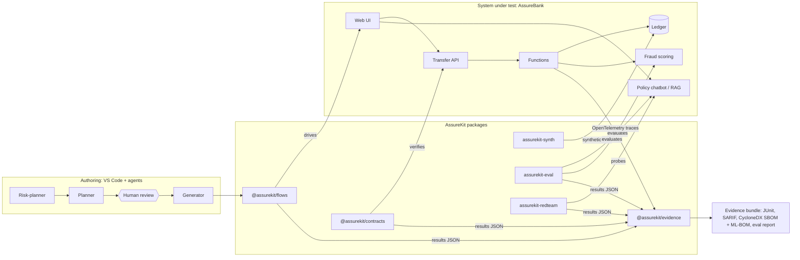
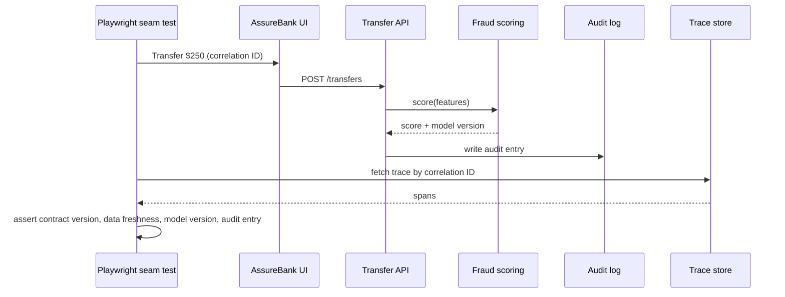

# AssureKit

**Open-source release assurance for FinTechs and credit unions: test the application, the data and the AI in one pipeline.**

[](https://github.com/malikan/assurekit/actions/workflows/ci.yml)
[](LICENSE)


AssureKit is developed and maintained by **[Malikan Inc.](#about-malikan-inc)** It is the open-source core of **AssureStack**, Malikan's six-stage quality and AI-assurance method (Assess, Design, Automate, Evaluate, Monitor, Transfer). Malikan uses AssureStack in client engagements; AssureKit packages the reusable parts so any engineering team can apply them without hiring anyone.

➡️ **Roadmap and release dates:** [ROADMAP.md](ROADMAP.md) · **Changes:** [CHANGELOG.md](CHANGELOG.md) · **Build plan:** [docs/IMPLEMENTATION_PLAN.md](docs/IMPLEMENTATION_PLAN.md)

---

## Why AssureKit

Most teams test the application in one place and validate AI models somewhere else. Real failures happen where the two meet:

- a correct model fed stale data by a broken API;
- a member-service chatbot that retrieves an outdated policy document;
- a fraud model silently degraded by an upstream data change.

AssureKit tests the application, its data and its AI **together, in the same automated release pipeline**, and turns the results into evidence mapped to the risk frameworks financial institutions are examined against. It is built for teams that cannot afford a large QA organization or a separate model-validation group.

## Status

AssureKit is in active pre-release development. Each module ships in a dated release; see [ROADMAP.md](ROADMAP.md).

| Module | Language | What it does | Status | Target release |
| --- | --- | --- | --- | --- |
| `assurekit-synth` | Python | Seeded synthetic members, accounts, card transactions and labelled fraud patterns; no real PII | In development | v0.1.0 |
| `assurekit-eval` | Python | LLM and RAG evaluation harness: golden datasets, deterministic metrics, calibrated LLM judges | Planned | v0.2.0 |
| AssureBank (`apps/assurebank`) | TypeScript | Reference serverless credit-union app with switchable fault injection | Planned | v0.3.0 |
| `@assurekit/flows` | TypeScript | Playwright fixtures and business flows: login, transfers, bill pay | Planned | v0.3.0 |
| `@assurekit/contracts` | TypeScript | OpenAPI and event contract tests, schema-diff alerts | Planned | v0.3.0 |
| `assurekit-redteam` | Python | Banking-specific prompt-injection and agent-misuse probes, tagged by OWASP ID | Planned | v0.4.0 |
| `@assurekit/agents` | Markdown | Governed planner, generator and healer agent definitions for VS Code and other agent hosts | Planned | v0.4.0 |
| `@assurekit/evidence` | TypeScript | Control-mapped, signed evidence bundle per release | Planned | v0.5.0 |
| `@assurekit/mobile` | TypeScript | Appium flows behind the same flow interface | Planned | after v1.0.0 |

## Architecture



AssureKit has four layers:

1. **Authoring.** AI agents help write tests inside the IDE. Every agent output reaches the suite through a human-approved pull request. Agents never merge their own changes.
2. **Test packages.** Small, independent packages: TypeScript where tests drive applications, Python where the evaluation ecosystem lives. They share one results format, [`schemas/results.schema.json`](schemas/results.schema.json).
3. **System under test.** Your application, or AssureBank, the reference app used for demos, tutorials and AssureKit's own tests.
4. **Evidence.** Results and traces are mapped to control and risk IDs and packaged as a signed evidence bundle for each release.

### Seam tests

A *seam test* is one scenario that crosses the application, data and AI layers and is asserted on a single distributed trace.



AssureBank ships **fault switches** (off by default) that reproduce the three seam failures, so you can watch the pipeline catch them:

| Fault switch | Seam failure it simulates | Expected gate |
| --- | --- | --- |
| `STALE_FEATURES` | Feature API serves cached balances | Data-freshness assertion fails |
| `OUTDATED_POLICY_DOC` | Superseded fee schedule stays in the chatbot's index | Citation-version eval fails |
| `AMOUNT_UNITS_CENTS` | Upstream sends amounts in cents instead of dollars | Data contract and seeded-fraud recall fail |

### Results format

Every AssureKit tool writes the same JSON shape, so the evidence package can combine them:

```json
{
  "schema": "assurekit.results/v1",
  "tool": "assurekit-eval",
  "tool_version": "0.2.0",
  "run_id": "2026-11-15T14-03-22Z-7f3a",
  "subject": { "name": "assurebank-chatbot", "version": "0.3.0" },
  "cases": [
    {
      "id": "policy-fee-001",
      "status": "failed",
      "metrics": { "citation_version_match": 0 },
      "risk_tags": ["OWASP-LLM09:2025", "NIST-AI-600-1:confabulation"],
      "trace_id": "4bf92f3577b34da6a3ce929d0e0e4736"
    }
  ]
}
```

### Framework mapping

Results carry risk and control tags so they can be traced to the frameworks credit unions and FinTechs reference:

- NIST AI Risk Management Framework 1.0 and the Generative AI Profile (NIST AI 600-1)
- U.S. Treasury Financial Services AI Risk Management Framework (FS AI RMF)
- OWASP Top 10 for LLM Applications (2025) and OWASP Top 10 for Agentic Applications (2026)
- CycloneDX SBOM and ML-BOM for software and AI inventory

AssureKit ships identifiers and mappings, not the text of these frameworks.

## Repository layout

```text
assurekit/
├── apps/
│   └── assurebank/        # reference app (v0.3.0)
├── packages/
│   ├── synth/             # assurekit-synth, Python (v0.1.0)
│   ├── eval/              # assurekit-eval, Python (v0.2.0)
│   ├── flows/             # @assurekit/flows, TypeScript (v0.3.0)
│   ├── contracts/         # @assurekit/contracts, TypeScript (v0.3.0)
│   ├── redteam/           # assurekit-redteam, Python (v0.4.0)
│   ├── agents/            # @assurekit/agents (v0.4.0)
│   └── evidence/          # @assurekit/evidence, TypeScript (v0.5.0)
├── schemas/               # shared JSON schemas
├── docs/                  # architecture, decision records, implementation plan
├── .github/               # CI, release workflow, Copilot instructions
├── ROADMAP.md
├── CHANGELOG.md
└── LICENSE                # Apache-2.0
```

## Quick start

Requirements: Python 3.12+ and [uv](https://docs.astral.sh/uv/). Node.js 24 LTS and pnpm are needed from v0.3.0.

```bash
git clone https://github.com/malikan/assurekit.git
cd assurekit
uv sync
uv run pytest
```

Generate synthetic test data (available from v0.1.0):

```bash
uv run assurekit-synth --members 100 --seed 42 --fraud-rate 0.02 --out out/
```

The same seed always produces byte-identical files, so tests built on the data are reproducible.

## Design principles

- **Agents author; deterministic code decides.** AI agents help write and maintain tests. The release gate runs plain, reproducible test code with no model in the loop, apart from the AI evaluation suites themselves.
- **Synthetic data only.** No real member data, ever. Emails use reserved example domains and identifiers are clearly synthetic.
- **Money is integers.** Amounts are stored in integer cents, never floating point.
- **Vendor-neutral.** Model providers and evaluators plug in through adapters; no single vendor sits in the core.
- **Evidence, not attestation.** AssureKit produces test evidence. Deciding what that evidence means for compliance stays with the institution.
- **Proportional.** Usable by a small credit union with one QA engineer, scalable to larger teams.

## Contributing

Issues and pull requests are welcome. Read [CONTRIBUTING.md](CONTRIBUTING.md) first. Commits follow [Conventional Commits](https://www.conventionalcommits.org/), and every change needs passing CI.

## Security

Report vulnerabilities privately as described in [SECURITY.md](SECURITY.md). Do not open public issues for security reports.

## Citing AssureKit

If you use AssureKit in research, cite it with the metadata in [CITATION.cff](CITATION.cff).

## About Malikan Inc.

Malikan Inc. builds AssureStack, a quality-engineering and AI-assurance method for FinTechs and credit unions, and maintains AssureKit as its open-source toolkit. AssureStack delivers the method client by client; AssureKit spreads it across the field.

Contact: <!-- TODO: add Malikan Inc. website and igdiakonov@gmail.com -->

## License

Copyright © 2026 Malikan Inc. Licensed under the [Apache License, Version 2.0](LICENSE).

## Disclaimer

AssureKit produces test evidence. It does not certify compliance with any law, regulation or framework. AssureKit is not affiliated with or endorsed by NCUA, NIST, the U.S. Department of the Treasury or OWASP.
